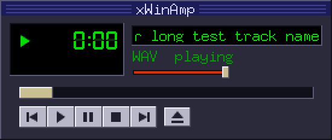

# xWinAmp

[](https://github.com/rooty/xwinamp/actions/workflows/ci.yml)

A Winamp-style audio player written in Go. macOS first, Linux and Windows later.

Status: player window with a playlist, CI and release builds (steps 1-4 of the initial plan).



## Layout

- `player/` - audio core: load a track, play, pause, stop, seek, volume. No UI code.
- `ui/` - main window on Ebitengine. `Controller` holds the logic (tested without a display), `draw.go` is the built-in skin.
- `playlist/` - track list, next/prev, repeat/shuffle, M3U. No UI code.
- `cmd/xwinamp/` - the desktop player; saves the playlist and settings between runs.
- `cmd/xwinamp-cli/` - terminal player built on `player`.
- `tools/mkicon/` - draws the app icon.
- `scripts/build-app.sh` - builds `dist/xWinAmp.app` on macOS.

Supported formats: MP3, WAV, FLAC, OGG Vorbis.

## Try it

```sh
go run ./cmd/xwinamp ~/Music/song.mp3 ~/Music/Album
```

Or start it without arguments and drop files or folders onto the window, or use
ADD in the playlist (PL button). Double-click a row to play it.

| Key | Action |
| --- | --- |
| Z / X / C / V / B | previous / play / pause / stop / next |
| S / R / P | shuffle / repeat / show playlist |
| Enter / Delete | play / remove the selected row |
| Space | pause / resume |
| ← / → | seek ∓5 s |
| ↑ / ↓ | volume ±5 % |

Click the time to switch between elapsed and remaining. `-scale 1..4` sets the window size (default 2).

The playlist, volume and modes are saved on exit to `playlist.m3u` and
`settings.json` in the user config directory (`~/Library/Application Support/xwinamp`
on macOS). Start with `-fresh` to ignore them.

Terminal player:

```sh
go run ./cmd/xwinamp-cli ~/Music/song.mp3 ~/Music/other.flac
```

While playing, type a command and press Enter: `p` pause/resume, `s` stop,
`n` next, `f`/`b` seek ±10s, `+`/`-` volume, `q` quit.

## Build requirements

- Go 1.25+ (required by Ebitengine 2.10)
- macOS and Windows: nothing else (no cgo needed).
- Linux: cgo plus ALSA and X11/OpenGL headers, e.g.
  `sudo apt install libasound2-dev libgl1-mesa-dev libxrandr-dev libxcursor-dev libxinerama-dev libxi-dev libxxf86vm-dev`.
  File dialogs need `zenity` or `kdialog` installed.

## macOS app

```sh
scripts/build-app.sh            # dist/xWinAmp.app and dist/xWinAmp-macos.zip
VERSION=1.0.0 scripts/build-app.sh
```

The app is a universal binary (Apple Silicon and Intel). It is ad-hoc signed,
not signed with a Developer ID, so on first launch open it with right click →
Open.

## Releases

Pushing a tag like `v0.1.0` runs `.github/workflows/release.yml`, which builds
the macOS app, a Linux binary and a Windows `.exe` and attaches them to a
GitHub Release. `.github/workflows/ci.yml` checks formatting, vet and tests on
Linux and macOS for every pull request.

## Tests

```sh
go test -race ./...
```

Tests use a fake audio output and a fake player, so they run without a sound card or a display.

## License

MIT, see [LICENSE](LICENSE). xWinAmp is an independent project, not affiliated
with Winamp; it uses no Winamp code or artwork.
